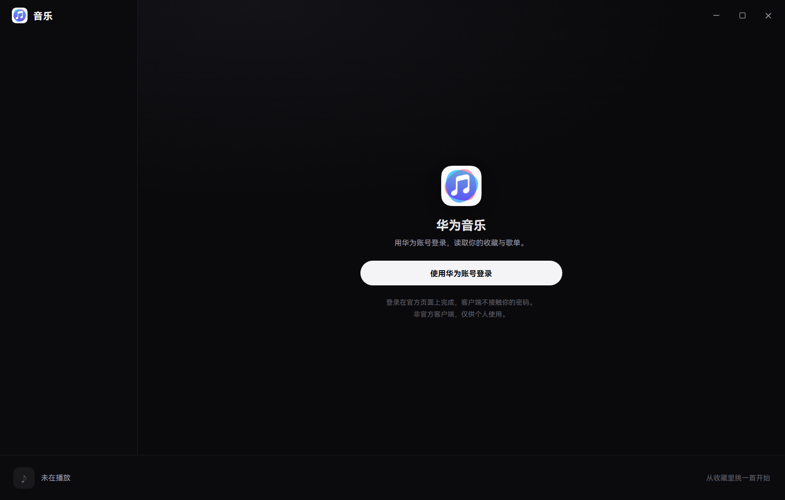

# 华为音乐 · Windows 客户端（自研 UI）

按**鸿蒙电脑版华为音乐**的观感重做的桌面客户端：深色打底、封面当主角、导航只有一层、播放器永远退到幕后。

这是一个**新的独立项目**，不是给 VutronMusic 换皮。协议层（登录、收藏、播放地址、歌词）沿用上一个学习版已验证的实现，界面全部重写。


| 音乐厅 | 我的歌单 |
|---|---|
|  |  |

| 歌单详情 | 我的收藏 |
|---|---|
|  |  |

| 设置 | 播放页 |
|---|---|
|  |  |

播放队列（右侧抽屉）与歌曲右键菜单：

| 播放队列 | 右键菜单 |
|---|---|
|  |  |

未登录时的引导页：



窗口放大到 2048 宽（最大化）时，内容收口、播放页两栏居中，不会把卡片拉成一条：

| 全屏 · 收藏 | 全屏 · 播放页 |
|---|---|
|  |  |

---

## 现在能做什么

| 能力 | 状态 | 说明 |
|---|---|---|
| 华为账号登录 | ✅ 可用 | 官方登录页嵌在主窗口 `WebContentsView`，扫完码自动回主界面 |
| 会话恢复 | ✅ 可用 | 凭据走 safeStorage，加密存在 userData 里，重启免登录 |
| 首页 | ✅ 可用 | 问候语 + 继续听大图 + 最近播放 + 收藏速览 |
| 音乐厅 | ✅ 可用 | 播放记录聚合的常听歌手 + 我的歌单 + 收藏精选（换一批） |
| 我的收藏 | ✅ 可用 | 全量分页拉取（154 首实测）、页内筛选、播放全部、取消收藏 |
| 歌单 | ✅ 可用 | 「我的歌单」整页宫格 + 详情页（分页加载、播放全部、返回），9 个歌单实测 |
| 搜索 | ✅ 可用 | 标题栏搜索走华为在线曲库，防抖 350ms、分页加载更多 |
| 设置 | ✅ 可用 | 账号与退出登录、音质、关闭行为、历史上报、第三方歌词、歌词缓存、关于 |
| 托盘 | ✅ 可用 | 托盘菜单（显示/播放控制/退出）+ 关闭到托盘，设置里可切换 |
| 播放 | ✅ 可用 | 单曲解析、播放/暂停、上下首、拖进度、音量、一个按钮切四种播放模式 |
| 播放页 | ✅ 可用 | 封面 + 歌词双栏、当前行高亮、点歌词跳转、音质徽标；收起时封面飞回播放条 |
| 播放条（统一） | ✅ 可用 | 收起/展开是同一条 76px bar：左曲目、中模式+传输键、右时间/收藏/队列/音量；封面与歌名用共享元素动画在 44px 与 320px 之间来回飞 |
| 播放队列 | ✅ 可用 | 右侧抽屉（开合都有动画）：正在播放 / 接下来 / 已播放，点行跳转、× 移除、清空待播 |
| 右键菜单 | ✅ 可用 | 任意歌曲行：立即播放 / 下一首播放 / 添加到播放队列 |
| 队列持久化 | ✅ 可用 | 关掉再开恢复上次队列 + 那一首 + 进度（暂停，不自动出声） |
| 窗口外壳 | ✅ 可用 | 无边框 + 自绘标题栏（拖拽/搜索/最小化/最大化/关闭），无系统白条 |
| 应用图标 | ✅ 可用 | 官方图标源图生成 ico/png/托盘，窗口与任务栏统一 |
| 登录页 | ✅ 可用 | 未登录时整页引导 + 登录中顶部取消条，侧栏收成一条 |
| 安装包 | ✅ 可用 | NSIS x64 内部安装包（未签名），本机安装 + 桌面快捷方式已实测启动 |
| 每日推荐 / 榜单 | ⬜ 未做 | 华为 `recommend/querydaily` 变体仍 400，不做假推荐替代 |

> 收藏数字是主进程分页拉全后按 ID 去重得到的，不是首屏数量。

---

## 跑起来

依赖已经装好了（`node_modules` 和上一版共用，含 Electron 44、React 19、electron-vite）。

```powershell
cd D:\Desktop\WorkSpace\huawei-music-win

# 单次构建
npm run build

# 启动（构建 + 拉起 Electron）
npm start
```

只想看截图的话：

```powershell
# 带调试端口启动
node_modules\electron\dist\electron.exe out/main/index.js --remote-debugging-port=9222
# 另一个终端
node tools/shots.mjs            # 窗口尺寸一套，输出到 docs/screenshots/
node tools/shots.mjs fullscreen # 全屏一套，输出 fullscreen-*.png
```

**注意**：本机 shell 默认导出 `ELECTRON_RUN_AS_NODE=1`，会让 Electron 变成纯 Node 直接报错。
命令前先 `Remove-Item Env:ELECTRON_RUN_AS_NODE`。

---

## 打包与桌面快捷方式

```powershell
Remove-Item Env:ELECTRON_RUN_AS_NODE -ErrorAction SilentlyContinue
npm run dist:win          # → release/win-x64/
```

产物：

| 东西 | 路径 |
|---|---|
| 安装包 | `release\win-x64\huawei-music-desktop-0.0.3-win-x64-setup-internal.exe`（约 107 MB，未签名） |
| 免安装目录 | `release\win-x64\win-unpacked\华为音乐.exe` |
| 安装后有快捷方式 | `%LOCALAPPDATA%\Programs\huawei-music-desktop\华为音乐.exe`（NSIS 关掉了自动建桌面图标） |
| 安装包版的数据目录 | `%APPDATA%\huawei-music-desktop`（按 `package.json` 的 `name`，不是 productName） |

**会话迁移的坑**：安装包版和 `electron out/main/index.js` 开发态的 userData 不是同一个目录
（`%APPDATA%\huawei-music-desktop` vs `%APPDATA%\Electron`），`session.enc` 用 `safeStorage` 加密，
密钥存在各目录的 `Local State` 里——只拷 `session.enc` 解不开，要连同 `Local State` 一起拷
（同一个 Windows 用户下可行）。不拷就在安装包里重新登录一次。

---

## 技术栈与目录

Electron 44 + React 19 + TypeScript + electron-vite。渲染层不引 UI 框架，样式全部手写（`styles.css`）。

```
src/
├── main/            # 主进程：窗口、IPC、登录、华为业务 HTTP、安全存储
│   ├── index.ts         # 应用入口、窗口、代理策略
│   ├── huawei.ts        # 登录页 WebContentsView + hms:// 回调拦截
│   ├── auth-manager.ts  # 登录/取消/登出状态机
│   ├── music-client.ts  # 华为业务接口封装
│   └── storage.ts       # safeStorage 会话、设置、队列
├── renderer/        # 渲染层（本次重写的部分）
│   ├── App.tsx          # 外壳：侧栏、路由、搜索、登录流程、toast
│   ├── screens.tsx      # 首页 / 收藏 / 登录
│   ├── pages.tsx        # 音乐厅 / 歌单 / 搜索 / 设置
│   ├── PlayerView.tsx   # 底部播放条 + 播放页内容层
│   ├── PlayerShell.tsx  # 播放条/播放页的共享元素过渡（Web Animations）
│   ├── QueuePanel.tsx   # 播放队列抽屉 + 歌曲右键菜单
│   ├── ui.tsx           # 封面、行、按钮等基础组件
│   ├── lib/api.ts       # IPC 薄封装（拆 Result、收藏分页、歌单、搜索）
│   ├── lib/player.ts    # 播放内核 hook（Audio 元素 + 队列）
│   ├── assets/          # 应用图标（脚本生成）
│   └── styles.css       # 设计令牌与全部样式
├── preload/         # contextBridge 白名单 API
└── shared/          # 主/渲染共用类型与 IPC 通道名
```

---

## 界面是怎么对齐鸿蒙电脑版的

| 鸿蒙电脑版 | 这里的实现 |
|---|---|
| 左侧四项导航（首页/音乐厅/café听/我的） | 首页 / 音乐厅 / 我的收藏 / 我的歌单 + 底部设置，账号收进设置页 |
| 顶部是系统标题栏 | **无边框自绘标题栏**（52px，上留白更松）：拖拽区 + 搜索 + 最小化/最大化/关闭，没有系统白条 |
| 音乐厅：大 banner + 筛选胶囊 + 横滑卡片 | 首页：继续听横幅（用当前封面做底图）+ 最近播放横滑 + 收藏速览；音乐厅：常听歌手横排 + 歌单宫格 + 收藏精选 |
| 播放是浮动小窗，左封面右歌词 | 全屏播放页，左封面右歌词居中排布，`Esc` 收起 |
| 播放条常驻底部、克制 | 76px 常驻播放条，2px 进度线，右侧音量，不抢内容 |
| 深色 + 封面发光 + 白色胶囊按钮 | 同一套：`#0a0a0c` 底、`#f4f4f6` 主按钮；封面只在卡片里发光，播放页用中性渐变，不做整屏模糊 |
| Hi-Res / 空间音频徽标 | 右上角音质徽标（无损 FLAC / 标准 MP3） |
| 华为音乐图标 | 用户提供的官方图标：`build/icon-src.png` → `scripts/make-icon.mjs` 生成 ico/png/托盘 |

布局按**桌面**逻辑走，不搬手机端：左侧固定导航 + 顶部自绘标题栏 + 底部常驻播放条，
内容区做密度（列表 56px 行高、封面卡片自动铺满），全站共用一条 1320 的内容列：
最大化时卡片 6 列 ×205、列表撑满同一右边界、设置表单收在 820，不会把一行卡片拉成整屏。
三档尺寸（960 / 1322 / 2048）的实测评审见 `docs/UI-REVIEW.md`。

设计令牌（颜色、圆角、字号、间距）集中在 `styles.css` 顶部的 `:root`，改一处全局生效。

---

## 数据从哪来

渲染层只调 `window.desktop`（`src/preload/index.ts` 暴露的白名单），主进程持有凭据、代理与全部业务 HTTP。

| 界面 | IPC |
|---|---|
| 登录状态 / 登录 / 取消 / 登出 | `auth.status` `auth.login` `auth.cancelLogin` `auth.logout` `auth.onProgress` |
| 收藏列表 | `music.favorites({start,limit})` + `music.favoritesSummary` |
| 歌单 | `music.playlists` + `music.playlistDetail({id,kind,start,limit})` |
| 搜索 | `music.search({query,start,limit})` |
| 最近播放 | `music.history` |
| 播放地址 | `music.resolvePlayback({trackId,quality})` |
| 歌词 | `music.lyrics({trackId,title,artist,...})` |
| 收藏/取消 | `music.favoriteState` / `music.setFavorite` |
| 设置与队列 | `settings.get/update`、`queue.load/save` |
| 关闭行为（托盘） | `window.setCloseBehavior('quit' \| 'tray')` |
| 歌词缓存 | `lyrics.cacheInfo` / `lyrics.clearCache({local})` |

接口细节（Digest 头、`resultCode === '000000'`、OAuth 链路）见 `docs/API_CONTRACT.md`，那是上一阶段真实账号验过的合同。

---

## 五个必须知道的坑

1. **华为 CDN 必须直连**。开 Clash 全局时音频请求会走代理，CDN 返 404，表现为「大部分歌点了没反应」。主进程已强制 `session.setProxy({ mode: 'direct' })`，不要再改回跟随系统。
2. **`ELECTRON_RUN_AS_NODE`**：见上，启动前清掉。
3. **userData 目录**：直接跑 `electron out/main/index.js` 时 Electron 用 `%APPDATA%\Electron`，老会话就在那里；用 `npx electron .` 会变成 `%APPDATA%\huawei-music-desktop`，登录态就「丢」了。要复用老会话就按 `npm start` 的方式启动。
4. **登录页高度耦合**：官方登录页是 `WebContentsView`，从 `y=48` 开始盖住窗口。渲染层的取消条必须正好 48px（`LOGIN_VIEW_TOP_INSET`），改一边要同步改另一边。
5. **音乐 token 约 7 天**，自动续期没打通。过期后接口返回授权错误，需要重新登录一次。

---

## 和别的目录什么关系

- `D:\Desktop\WorkSpace\huawei-music\app`：上一阶段的学习版（Linux 验证、完整自动化测试）。**只读参考，不要改**。
- `D:\Desktop\WorkSpace\huawei-music-vutron`：VutronMusic 分支实验，已放弃，留档。
- 本目录：当前主线。

旧版 README 与全部协议/验收文档都保留在 `docs/`（`LEGACY-README.md`、`API_CONTRACT.md`、`IMPLEMENTATION_*.md` 等）。

---

## 合规

非官方客户端，仅供个人学习研究。OAuth 的 `client_id` 属于华为官方音乐应用，不得分发、不得商用、不得公开仓库或产物。`.local/`、真实凭据、个人音乐库数据都不进版本库、不进安装包。
