# 华为音乐 · Windows 客户端（非官方）

> **⚠️ 非官方项目，与华为及其关联公司无隶属、合作或代理关系，未获授权、认可或技术支持。**
>
> 这个项目只是把**你自己华为账号里已有权益的内容**，用一个桌面界面播出来：
> 不含任何音源、不下载、不破解、不绕过付费/会员/地域/DRM 限制。能听什么完全取决于你的账号。
>
> 需要**你自己的华为账号**（无损音质需要账号本身有会员）。使用第三方客户端是否违反服务条款、
> 以及账号可能受限的风险，由使用者自行判断和承担。

按**鸿蒙电脑版华为音乐**的观感重做的桌面客户端：深色打底、封面当主角、导航只有一层、播放器永远退到幕后。
协议层与初始结构基于上游项目修改，界面与播放器为本项目重写，来源与许可见[文末](#来源与许可)。

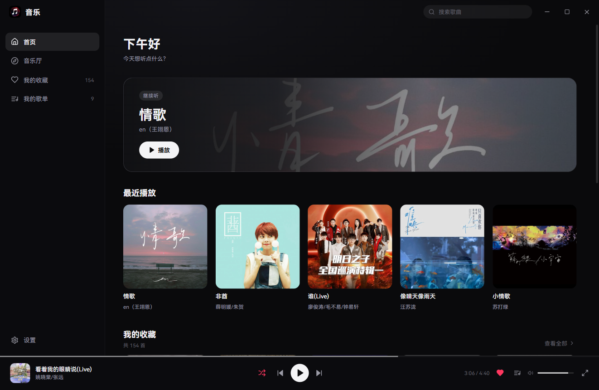

| 音乐厅 | 我的歌单 |
|---|---|
| 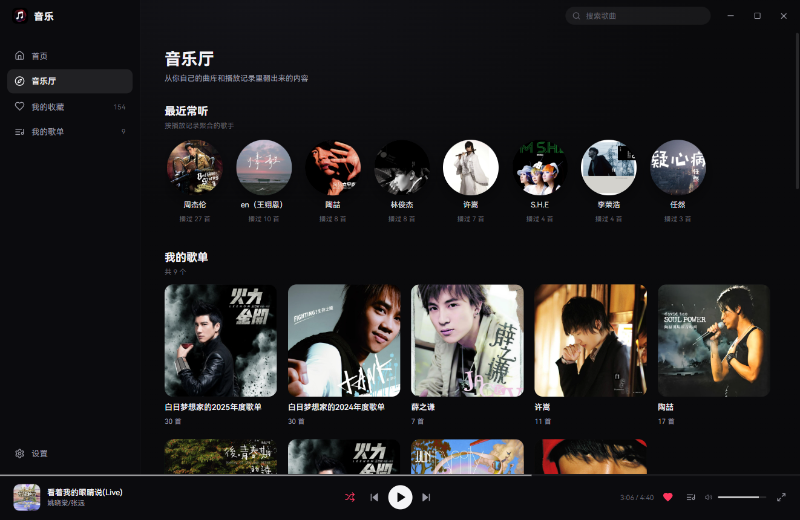 | 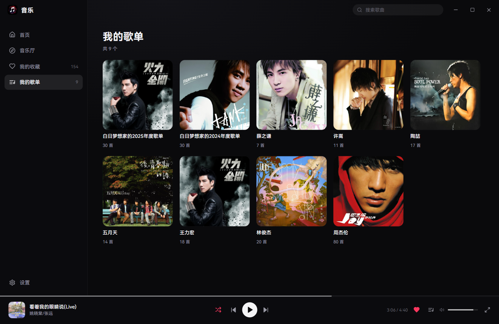 |

| 歌单详情 | 我的收藏 |
|---|---|
| 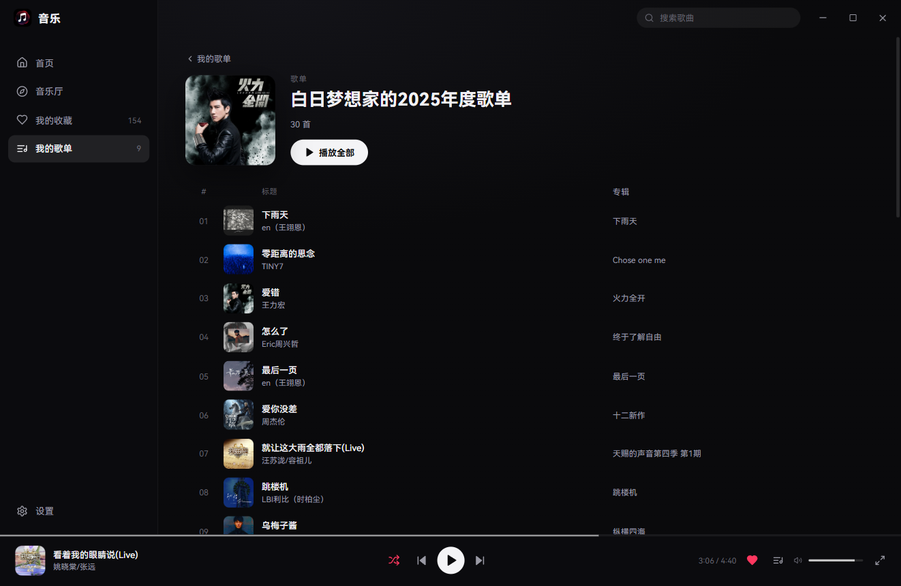 | 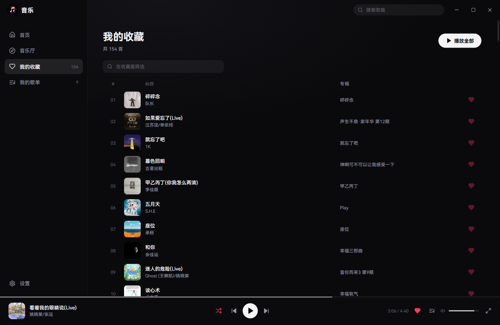 |

| 设置 | 播放页 |
|---|---|
| 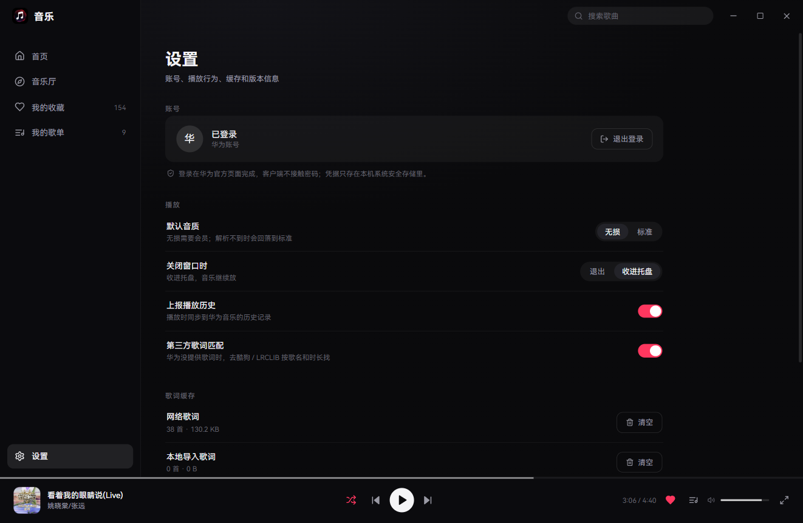 | 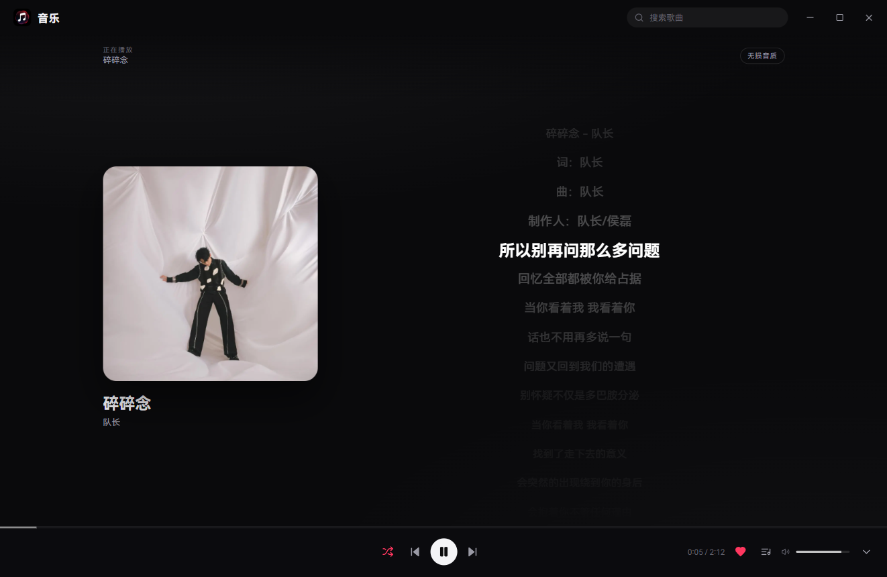 |

播放队列（右侧抽屉）与歌曲右键菜单：

| 播放队列 | 右键菜单 |
|---|---|
| 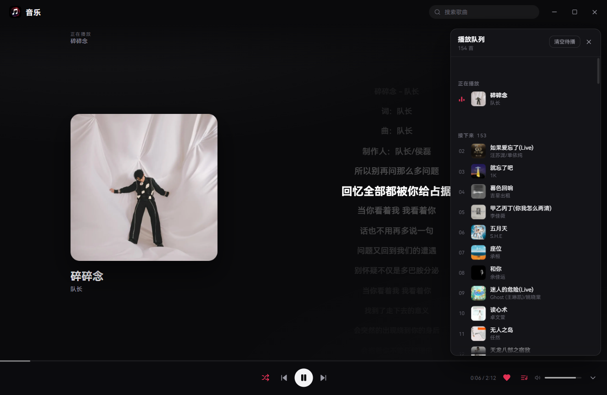 | 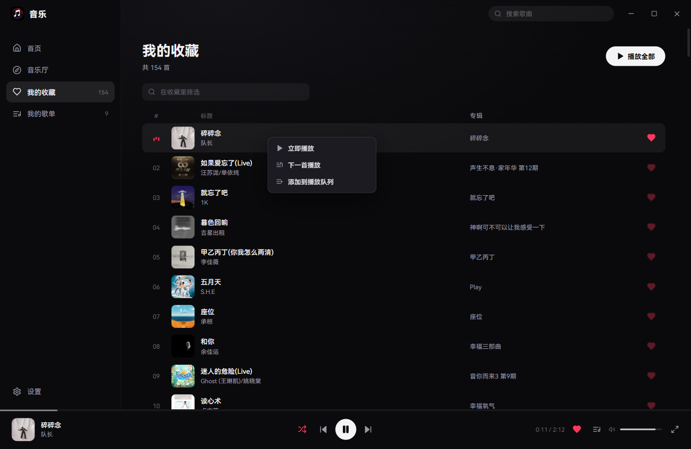 |

窗口放大到 2048 宽（最大化）时，内容收口、播放页两栏居中，不会把卡片拉成一条：

| 全屏 · 收藏 | 全屏 · 播放页 |
|---|---|
| 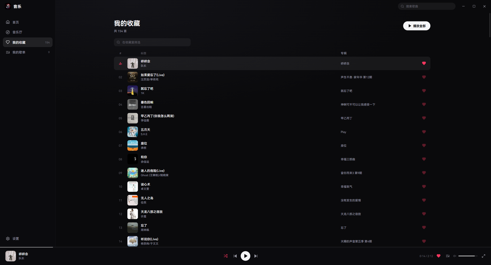 | 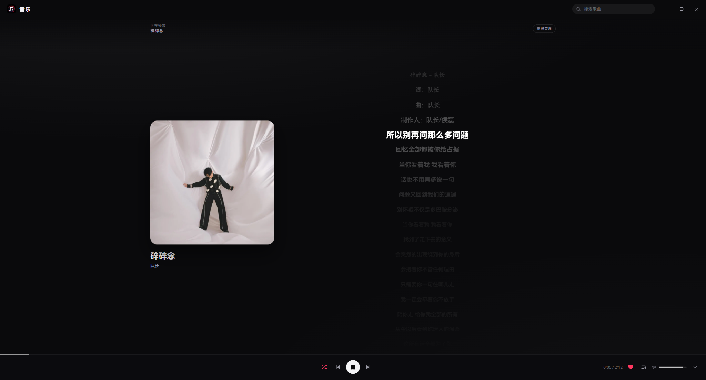 |

---

## 现在能做什么

| 能力 | 状态 | 说明 |
|---|---|---|
| 华为账号登录 | ✅ 可用 | 官方登录页嵌在主窗口 `WebContentsView`，扫完码自动回主界面 |
| 会话恢复 | ✅ 可用 | 凭据走 safeStorage，加密存在 userData 里，重启免登录 |
| 首页 | ✅ 可用 | 问候语 + 继续听大图 + 最近播放 + 收藏速览 |
| 音乐厅 | ✅ 可用 | 播放记录聚合的常听歌手 + 我的歌单 + 收藏精选（换一批） |
| 我的收藏 | ✅ 可用 | 全量分页拉取、页内筛选、播放全部、取消收藏 |
| 歌单 | ✅ 可用 | 「我的歌单」整页宫格 + 详情页（分页加载、播放全部、返回） |
| 搜索 | ✅ 可用 | 标题栏搜索走在线曲库，防抖 350ms、分页加载更多 |
| 设置 | ✅ 可用 | 账号与退出登录、音质、关闭行为、历史上报、第三方歌词、歌词缓存、关于 |
| 托盘 | ✅ 可用 | 托盘菜单（显示/播放控制/退出）+ 关闭到托盘，设置里可切换 |
| 播放 | ✅ 可用 | 单曲解析、播放/暂停、上下首、拖进度、音量、一个按钮切四种播放模式 |
| 播放页 | ✅ 可用 | 封面 + 歌词双栏、当前行高亮、点歌词跳转、音质徽标；收起时封面飞回播放条 |
| 播放条（统一） | ✅ 可用 | 收起/展开是同一条 76px bar：左曲目、中模式+传输键、右时间/收藏/队列/音量；封面与歌名用共享元素动画在 44px 与 320px 之间来回飞 |
| 播放队列 | ✅ 可用 | 右侧抽屉（开合都有动画）：正在播放 / 接下来 / 已播放，点行跳转、× 移除、清空待播 |
| 右键菜单 | ✅ 可用 | 任意歌曲行：立即播放 / 下一首播放 / 添加到播放队列 |
| 队列持久化 | ✅ 可用 | 关掉再开恢复上次队列 + 那一首 + 进度（暂停，不自动出声） |
| 窗口外壳 | ✅ 可用 | 无边框 + 自绘标题栏（拖拽/搜索/最小化/最大化/关闭），无系统白条 |
| 每日推荐 / 榜单 | ⬜ 未做 | 官方 `recommend/querydaily` 变体仍 400，不做假推荐替代 |
| 下载 / 离线 | ⬜ 不做 | 不提供解密、转存、离线导出 |

> 收藏数字是主进程分页拉全后按 ID 去重得到的，不是首屏数量。

---

## 跑起来

需要 **Node.js 22.15+**（Windows / Linux / macOS 均可开发，安装包目前只出 Windows x64）。

```powershell
git clone https://github.com/Daydreamcgy/huawei-music-win.git
cd huawei-music-win
npm ci
npm start          # 构建 + 拉起 Electron
```

只构建：`npm run build`（`tsc --noEmit` + electron-vite）；类型检查：`npm run typecheck`。

**Windows 上有个坑**：本机如果导出了 `ELECTRON_RUN_AS_NODE=1`，Electron 会退化成纯 Node 直接报错，
启动前清掉：

```powershell
Remove-Item Env:ELECTRON_RUN_AS_NODE -ErrorAction SilentlyContinue
```

## 打包

```powershell
npm run dist:win          # → release/win-x64/
```

产物是未签名的 NSIS 安装包 `huawei-music-desktop-<version>-win-x64-setup-unofficial.exe`。
未签名意味着首次安装会被 SmartScreen / 部分杀软拦一下，需要手动「仍要运行」。
安装包版的数据目录是 `%APPDATA%\huawei-music-desktop`（按 `package.json` 的 `name`，不是 `productName`）。

---

## 技术栈与目录

Electron 44 + React 19 + TypeScript + electron-vite。渲染层不引 UI 框架，样式全部手写（`styles.css`）。

```
src/
├── main/            # 主进程：窗口、IPC、登录、业务 HTTP、安全存储
│   ├── index.ts         # 应用入口、窗口、代理策略
│   ├── huawei.ts        # 登录页 WebContentsView + hms:// 回调拦截
│   ├── auth-manager.ts  # 登录/取消/登出状态机
│   ├── music-client.ts  # 业务接口封装
│   └── storage.ts       # safeStorage 会话、设置、队列
├── renderer/        # 渲染层
│   ├── App.tsx          # 外壳：侧栏、路由、搜索、登录流程、toast
│   ├── screens.tsx      # 首页 / 收藏 / 登录
│   ├── pages.tsx        # 音乐厅 / 歌单 / 搜索 / 设置
│   ├── PlayerView.tsx   # 底部播放条 + 播放页内容层
│   ├── PlayerShell.tsx  # 播放条/播放页的共享元素过渡（Web Animations）
│   ├── QueuePanel.tsx   # 播放队列抽屉 + 歌曲右键菜单
│   ├── ui.tsx           # 封面、行、按钮等基础组件
│   ├── lib/api.ts       # IPC 薄封装（拆 Result、收藏分页、歌单、搜索）
│   ├── lib/player.ts    # 播放内核 hook（Audio 元素 + 队列）
│   └── styles.css       # 设计令牌与全部样式
├── preload/         # contextBridge 白名单 API
└── shared/          # 主/渲染共用类型与 IPC 通道名
```

设计令牌（颜色、圆角、字号、间距）集中在 `styles.css` 顶部的 `:root`，改一处全局生效。

---

## 界面是怎么对齐鸿蒙电脑版的

| 鸿蒙电脑版 | 这里的实现 |
|---|---|
| 左侧四项导航（首页/音乐厅/café听/我的） | 首页 / 音乐厅 / 我的收藏 / 我的歌单 + 底部设置，账号收进设置页 |
| 顶部是系统标题栏 | **无边框自绘标题栏**（52px，上留白更松）：拖拽区 + 搜索 + 最小化/最大化/关闭，没有系统白条 |
| 音乐厅：大 banner + 筛选胶囊 + 横滑卡片 | 首页：继续听横幅（用当前封面做底图）+ 最近播放横滑 + 收藏速览；音乐厅：常听歌手横排 + 歌单宫格 + 收藏精选 |
| 播放是浮动小窗，左封面右歌词 | 全屏播放页，左封面右歌词居中排布，`Esc` 收起 |
| 播放条常驻底部、克制 | 76px 常驻播放条，2px 进度线，右侧音量，不抢内容 |
| 深色 + 封面发光 + 白色胶囊按钮 | 同一套：`#0a0a0c` 底、`#f4f4f6` 主按钮；封面只在卡片里发光，播放页用中性渐变，不做整屏模糊 |
| Hi-Res / 空间音频徽标 | 右上角音质徽标（无损 FLAC / 标准 MP3） |

布局按**桌面**逻辑走，不搬手机端：左侧固定导航 + 顶部自绘标题栏 + 底部常驻播放条，
内容区做密度（列表 56px 行高、封面卡片自动铺满），全站共用一条 1320 的内容列。
三档尺寸（960 / 1322 / 2048）的实测评审见 `docs/UI-REVIEW.md`。

应用图标是本项目自绘的（源图 `build/icon-src.png`），不含任何厂商官方标识。

---

## 数据与隐私

- 渲染层只调 `window.desktop`（`src/preload/index.ts` 暴露的白名单），主进程持有凭据、代理与全部业务 HTTP。
- 密码不经过客户端：登录在华为官方页面上完成，客户端只接回调。
- 会话用 `safeStorage` 加密存本地；退出登录即清。
- 无遥测、无崩溃上报、无自动更新检查；日志不写 URL query、请求体、Authorization 或曲目私人标识。
- `.local/`、`research/`、真实账号数据、抓包内容都不在版本库里（见 `.gitignore`）。

## 已知限制

1. **必须直连华为 CDN**：开全局代理时音频请求会走代理，CDN 返 404，表现为「大部分歌点了没反应」。
   主进程已强制 `session.setProxy({ mode: 'direct' })`，不要改回跟随系统。
2. **登录页高度耦合**：官方登录页是 `WebContentsView`，从 `y=48` 开始盖住窗口；
   渲染层的取消条必须正好 48px（`LOGIN_VIEW_TOP_INSET`），改一边要同步改另一边。
3. **音乐 token 约 7 天**，自动续期没打通；过期后接口返回授权错误，需要重新登录一次。
4. **OAuth 身份不是本项目注册的**：登录用的 `client_id` 是公开的第三方应用标识，可能随时失效；
   客户端没有能力、也不应该绕过这一点。
5. **接口全部来自抓包与兼容性实验**，随时可能改动或失效，本项目不承诺持续可用。

---

## 参与贡献

欢迎 Issue 与 PR，但请先确认方向属于本项目的合法使用范围：

- **不接受**绕过付费/会员/地域/版权限制、音频解密、接口滥用、批量抓取，或引入其它音乐平台音源、
  账号代理、云端转发的改动。
- 修复缺陷、改进可访问性与中文排版、补充测试、提升跨平台兼容性是受欢迎的方向。
- 提交前请通过 `npm test`、`npm run typecheck`、`npm run build`。
- 不要提交 `.local/`、`research/`、真实账号数据、Token、Cookie 或抓包内容；测试请使用合成数据。

---

## 来源与许可

本项目基于 [talongao/huawei-music-desktop](https://github.com/talongao/huawei-music-desktop)（AGPL-3.0-only）修改而来：
自 2026-10-24 起重写渲染层与界面、重塑播放条与播放页、新增播放队列与 Windows 安装程序、替换应用图标。
原项目版权归其作者所有，修改声明见 [`NOTICE`](NOTICE)。

代码以 **GNU Affero General Public License v3.0（AGPL-3.0-only）** 授权：完整条款见 [`LICENSE`](LICENSE)。

- 可以用于任何目的、修改并再分发，但**分发衍生作品（或通过网络提供服务）时必须同样以 AGPL-3.0 提供完整对应源码**，
  并保留版权与许可声明，不提供任何担保。
- **许可证只覆盖本仓库的代码**。它不授予：华为服务的接口使用权、华为音乐内容的使用权、
  「华为 / HUAWEI / 华为音乐」等名称与商标的使用权，也不代表任何官方身份或与华为的合作关系。
- 「华为音乐」在本仓库中仅用于说明所兼容的服务。

## 文档索引

| 文档 | 内容 |
|---|---|
| [实现进度](docs/IMPLEMENTATION_STATUS.md) | 各阶段进度、验证范围与证据 |
| [技术设计](docs/TECH-DESIGN.md) | 架构、播放条/播放页过渡、动画参数 |
| [接口契约](docs/API_CONTRACT.md) | 已验证的接口参数与常见陷阱 |
| [界面评审](docs/UI-REVIEW.md) | 960 / 1322 / 2048 三档尺寸的实测记录 |
| [登录与令牌研究](docs/login-research.md) | 回跳、token 生命周期与已知失效路径 |

---

**本仓库及其产物与华为无任何关系。** 权利人如认为本项目涉及其合法权益，请通过 Issue 联系，
维护者会核查并视情况调整或移除相关内容。以上不构成法律意见。
